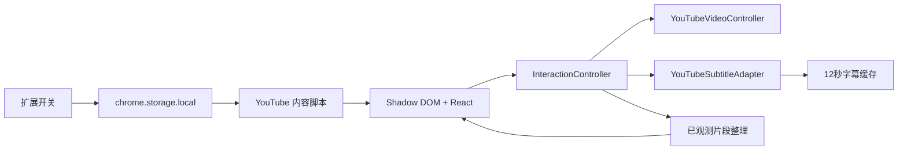
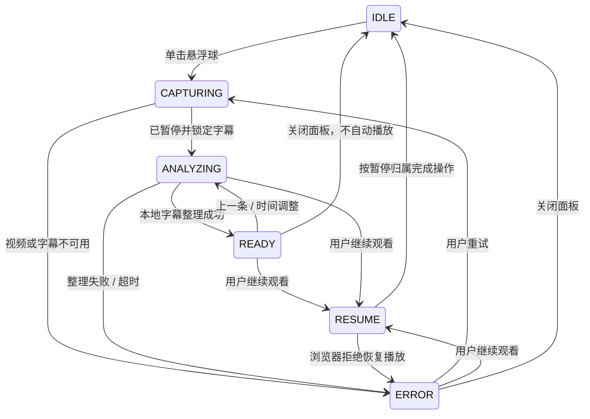

# FlowWord 0.1.0 架构

## 当前范围

实现 S0/S1 的悬浮球、视频控制、字幕捕获及原文气泡。没有提前引入账户、远程服务、词典或收藏数据库。

## 模块

| 模块 | 文件 | 职责 |
| --- | --- | --- |
| 交互状态机 | `src/core/interaction-controller.ts` | 捕获、取消、超时、暂停归属与显式恢复 |
| 视频与字幕适配器 | `src/adapters/youtube.ts` | 主视频定位、平台选择器、英文轨道和页面字幕 |
| 字幕缓存 | `src/core/subtitle-cache.ts` | 去重、时间边界、跳转清理、容量限制 |
| 句子整理 | `src/core/sentence.ts` | 整理空白与已观测片段重叠，不生成英文 |
| 位置算法 | `src/core/geometry.ts` | 边界约束、贴边、相对位置、面板避让 |
| 悬浮界面 | `src/ui/FloatingApp.tsx` | 拖动、字幕面板、键盘反馈 |
| 设置 | `src/storage/settings.ts` | 独立键写入、校验损坏设置、默认关闭 |
| 内容脚本 | `entrypoints/flowword.content.tsx` | 生命周期、SPA 导航、媒体变化和全屏挂载 |
| 弹出界面 | `entrypoints/popup/` | 开关、页面连接状态、重置位置 |
| 后台 | `entrypoints/background.ts` | 根据持久化设置更新图标标识 |

## 状态机

任意导航、媒体换源、用户手动播放或拖动进度都可以 reset 回 IDLE。每次异步操作拥有独立 AbortController 和操作编号；旧结果不能覆盖新状态。取消会立即结束等待并清理超时计时器。

“关闭气泡”与“放弃暂停归属”不同：关闭后视频仍暂停，再次查看仍可以明确继续观看。换源、进度变化或外部播放后则放弃归属。恢复播放前校验视频元素、编号、媒体源和时间，防止误操作旧视频。

核心状态位于当前页面的交互控制器。扩展设置持久化到独立存储键，不依赖 MV3 Service Worker 内存。

## 字幕数据流

1. 插件关闭时不采样；仅在已开启的标准视频页采样
2. 每 150ms 读取单一英文字幕轨道的 activeCues，失败时读取可见 DOM 字幕
3. 正常采样不遍历全部轨道字幕；查询偏移和上一条时才检索选中轨道 cues
4. 点击时记录视频时间，立即暂停，再进行同步字幕快照与本地整理
5. DOM 片段只保存观测起止时间；标准轨道保留原有起止时间
6. 句子整理最多向前拼两段；存在结束标点、大时间间隔或超过 8 秒时停止
7. 页面字幕语言记为 und，不能以拉丁字母过滤冒充英语检测
8. 缓存出现大幅跳转或视频身份变化时清空

## 后续扩展接口

`VideoPort`、`SubtitlePort`、`SentenceProcessor` 和统一模型位于 `src/core/types.ts`。添加网站适配器时复用 UI 和控制器。S2 再引入 VocabularyAnalyzer / DifficultyRanker / DictionaryProvider；S3 在扩展来源下建立 IndexedDB 词库，不把学习资料存入 YouTube 页面的 IndexedDB。

当前没有候选、生词概率或词义的模拟实现。
