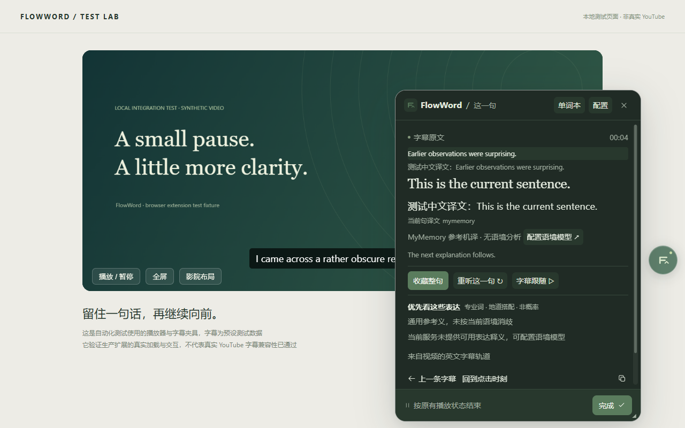
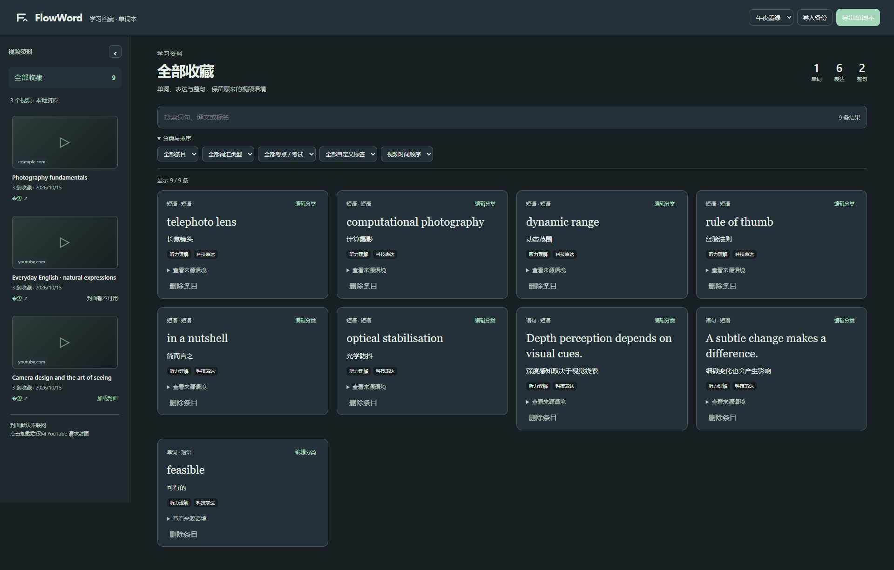

# FlowWord

**停一下，看懂这一句**

FlowWord 是面向 Chrome / Edge 的英文视频学习扩展。点击悬浮球暂停视频，查看当前英文字幕、中文翻译和语境表达；把单词、词组或整句连同视频来源一起收藏，方便回看。

当前版本：**0.5.1** · Chrome Manifest V3 · WXT + React + TypeScript

[安装与使用](INSTALL.md) · [开发说明](docs/DEVELOPMENT.md) · [文档导航](docs/README.md) · [更新记录](CHANGELOG.md)

## 可以做什么

| 功能 | 操作与效果 |
| --- | --- |
| 暂停与恢复 | 左键点击球暂停并捕获字幕，再次点击继续播放并关框 |
| 整句翻译与表达解释 | 整句和表达并行准备，成功结果先显示，专业词、搭配和地道表达优先 |
| 上下文阅读 | 小号英文上文与下文放在当前句两侧，点击邻句展开中文 |
| 句子重听与字幕跟随 | 重听当前字幕范围，或播放中跟随字幕更新面板 |
| 语境收藏 | 收藏单词、词组、整句，保留视频、时间戳、原句和当时释义 |
| 快捷词本与完整档案 | 悬浮框内搜索最近收藏，完整词本支持视频筛选、分类、标签及备份 |
| 自定义外观 | 默认暗绿色，支持多主题、字号、独立框尺寸、球颜色与自由定位 |
| 框内模型设置 | 默认预填 DeepSeek，可修改兼容接口；配置时保留已有密钥 |

默认快捷键：`Alt+Shift+P` 暂停/恢复，`Alt+Shift+R` 重听当前字幕，可在浏览器扩展快捷键页面改绑。

## 界面预览

以下截图使用本地自编字幕和演示收藏，不代表真实网站兼容性或模型准确率测试。

### 字幕学习面板



### 视频学习档案



## 从源码运行

需要满足 `package.json` 中的 Node.js 版本要求，推荐 Node.js 24。以下命令在项目根目录执行。

```powershell
npm ci                # 按锁定版本安装依赖
npm run build         # 生成生产扩展
```

在 `chrome://extensions` 或 `edge://extensions` 开启开发者模式，选择“加载已解压的扩展程序”，加载 **`.output/chrome-mv3`**。

打开有英文字幕的受支持视频页，在工具栏 FlowWord 中开启悬浮球。其他网站需要先在工具栏中为当前站点单独授权并刷新。详细配置见 [安装说明](INSTALL.md)。

已安装用户应在**原加载路径**重新加载，避免因扩展 ID 改变而看不到原有数据。更换路径前先导出词本备份。

## 翻译配置与数据

- 右键悬浮球 → 模型设置，在原框内填写接口、模型和 API Key，授权并保存
- 默认预填 DeepSeek，联网初始关闭；已有服务选择保留，不自动切换供应商
- 云端收到当前字幕及最多两句邻近字幕，不发送视频网址；费用和数据处理由所选供应商决定
- MyMemory 是可主动选择的整句参考服务，不提供模型语境分析
- 密钥保存在扩展来源的 IndexedDB，不写入源码、`storage.local` 或词本备份，不回填到输入框
- 视频学习档案、收藏和设置保存在本机；通过 JSON 导出/导入备份词本
- 视频封面当前仍需手动加载，**自动封面和轻量复习尚未实现**

请勿把 API Key、个人词本备份或浏览器资料提交到仓库。源码使用浏览器设置配置密钥，不需要 `.env`。

## 速度与兼容边界

可选播放预译和词组预解析，两类结果均有持久缓存。首次请求、新字幕、跳转、预算用尽或网络异常仍可能等待，不保证零延迟。

YouTube 主要适配普通 `watch` 页面；其他网站主要支持顶层可见 HTML5 主视频和已启用的英文原生字幕。自绘播放器字幕、跨域 iframe、无字幕视频需要专门适配。YouTube 直播、Shorts 和系统播放器不在当前支持范围内。

原生字幕重听按 `cue.end` 结束；页面 DOM 字幕通过实际字幕转换判断，自动字幕无标点时不能保证完整语义句末。模型译文也仍需核对。

## 开发、测试与打包

```powershell
npm run dev               # 启动开发构建
npm run typecheck         # 检查类型
npm test                  # 运行单元测试
npm run browser:install   # 首次准备项目内测试浏览器
npm run verify            # 类型、单测、生产构建和浏览器回归
npm run zip               # 生成 .output 下的扩展 ZIP
```

0.5.1 的发布验证记录为 235 项单元测试、74 个浏览器场景。浏览器场景主要使用隔离资料、本地字幕夹具和模拟云响应，不能据此宣称所有真实网站、真实模型速度和系统快捷键都已验证。详见 [测试报告](TEST_REPORT.md)。

`npm run package` 用于维护者整理本机发布目录，并复制验证证据；新克隆仓库没有历史 `test-results` 时可能缺少输入文件。普通源码安装使用 `build`，ZIP 分发使用 `zip`。

## 目录结构

```text
entrypoints/      扩展后台、视频内容脚本和页面入口
src/
  adapters/       视频与字幕适配
  core/           字幕整理、交互和重听控制
  services/       翻译请求、缓存调度和预译
  storage/        本地设置、词本和视频归档
  ui/             悬浮界面与复用组件
public/           图标等静态资源
tests/            单元测试及本地测试夹具
scripts/          浏览器回归、构建辅助与打包脚本
docs/             开发文档、审查结果和历史修改说明
INSTALL.md        安装与升级说明
TEST_REPORT.md    发布验证与未覆盖范围
CHANGELOG.md      版本更新记录
```

`node_modules`、`.cache`、`.wxt`、`.output`、`test-results` 和 `release` 是本机依赖或生成目录，已从 Git 排除。ZIP 可通过 GitHub Releases 单独分发。

## 下一步

自动视频封面、翻译取消与预译预算修正、备份一致性、词本来源展示和轻量复习均处于待开发阶段。当前已知问题和建议顺序见 [后续计划](docs/ROADMAP.md) 与 [0.5.1 审查](docs/REVIEW_0.5.1.md)。

仓库尚未指定开源许可证。
